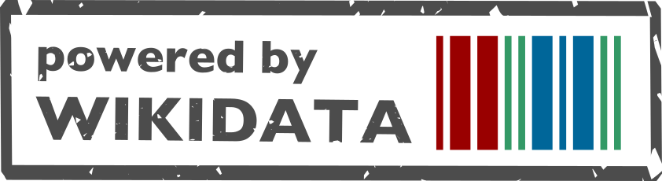

# LinkedMusic Data Lake

[LinkedMusic](https://linkedmusic.ca/) is an open-source project that combines detailed music metadata from many independent databases into one searchable RDF graph. It brings together information about musical works, performances, recordings, composers, and performers, spanning repertoires from Irish traditional music to jazz solos to medieval chant, and links them through a common vocabulary so they can be explored together through a single endpoint.

Music metadata today is scattered across hundreds of databases, each with its own fields, identifiers, and access methods. Studying a single composer or work means juggling many interfaces and reconciling inconsistent naming by hand ("Mozart, W.A." vs. "Wolfgang Amadeus Mozart"?). LinkedMusic addresses this by reconciling every dataset's entities to [Wikidata](https://www.wikidata.org/), giving them shared, stable identifiers, and converting the result to [RDF](https://en.wikipedia.org/wiki/Resource_Description_Framework), loaded into a [Virtuoso](https://virtuoso.openlinksw.com/) triplestore that can be queried with SPARQL.

For the full project background, see the [wiki](https://github.com/DDMAL/linkedmusic-datalake/wiki).

## This repository

This repo is the **ingestion codebase** behind the data lake. For each source database it follows a common pipeline: fetch → reconcile against Wikidata (via OpenRefine) → convert to RDF → upload to Virtuoso (though the details vary by source). It also holds independent graph-evaluation tools and SPARQL query controls. Ontology visualizations live in the wiki; natural-language query context and application benchmarks live in the separate [SESEMMI repository](https://github.com/DDMAL/SESEMMI).

The generated data itself is **not** committed — most datasets are far too large, so the per-subproject `data/` folders only exist locally. See the [pipeline overview](https://github.com/DDMAL/linkedmusic-datalake/wiki/Current-Pipeline-for-Adding-a-New-Dataset) to learn about the ingestion process.

## Querying the data

The recommended way to explore the graph is [SESEMMI](https://sesemmi.linkedmusic.ca/) (Search Engine System for Enhancing Music Metadata Interoperability), our web front end for the data lake.


SESEMMI translates plain-language questions into SPARQL for you, and also provides a SPARQL input field if you'd rather write queries by hand. For developers, our Virtuoso SPARQL endpoint is available at [https://virtuoso.simssa.ca/sparql/](https://virtuoso.simssa.ca/sparql/).

For queries across datasets, see the [identifier review and tested query
patterns](evaluation/identifier_review.md). They cover both direct Wikidata
identifiers and source entities linked through P2888 while retaining graph and
source-node evidence.

## Repository structure

There is one folder per source database (listed under [Datasets](#datasets)). Most follow the same layout, though not every subproject uses every subdirectory:

- `data/` — data files, typically split into `archived/`, `extracted/`, `unreconciled/`, `reconciled/`, and `rdf/` stages. Almost none of these are committed, due to their size.
- `doc/` — documentation.
- `openrefine/` — OpenRefine history and export files.
- `src/` — scripts. Most scripts assume the current working directory is the subproject's `src/`.

The repository root also holds:

- `shared/` — code reused across subprojects: a config-driven RDF conversion tool (`rdfconv/`, with per-subproject configs in `rdf_config/`), a Wikidata API client (`wikidata_utils/`), and standalone utilities.
- [`evaluation/`](evaluation/README.md) — independent graph-evaluation manifests, fidelity/reconciliation protocol, competency SPARQL queries, offline controls and read-only audit tooling.
- [`LINKEDMUSIC-HANDOFF.md`](LINKEDMUSIC-HANDOFF.md) — latest task history, validation evidence, publication status, deferred deployment and next work.
- `pyproject.toml` / `poetry.lock` — Python dependencies, managed with Poetry (one environment for the whole repo).

A few subprojects also retain an older `jsonld_approach/` folder. Follow each dataset's README for its supported conversion route; the SIMSSA shared CSV-to-Turtle route has regression coverage, but its historical deployment has not been established.

## Preservation and evaluation status

As of **29 October 2026**, the local conversion code includes the following
repairs. The linked contracts describe input boundaries, query compatibility,
regression coverage and regeneration procedures.

| Area | Implemented behavior and documentation |
| --- | --- |
| RISM | [Canonical Wikidata item IRIs and retained topic matches](rism/doc/identifier_normalization.md). |
| MusicBrainz | [33 specific contributor roles and relationship evidence](musicbrainz/doc/relationship_preservation.md), [reviewed query representation](musicbrainz/doc/representation_review.md), [complete item URLs](musicbrainz/doc/url_recognition.md), and [text-preserving, isolated auxiliary CSV lookups](musicbrainz/doc/auxiliary_identifier_validation.md). |
| APSearch / CKG | [Original creation periods, paired year bounds and review flags](ckg-apsearch/doc/creation-period-preservation.md). Generic CKG person links remain role-unspecified. |
| Shared CSV conversion | [Whole-identifier recognition, explicit literal handling and local-key precedence](shared/rdf_conversion/identifier_preservation.md). Existing missing-value parsing and conditional mappings still limit preservation. |
| Global Jukebox / SIMSSA | [Literal alternative names](theglobaljukebox/doc/alternative_names_mapping.md) and [original person labels with guarded Wikidata exact matches](simssa/doc/person_identifier_mapping.md). |
| DIAMM | [Bare-QID validation](diamm/doc/identifier_validation.md), [years and approximation](diamm/doc/person_years.md), [original names/floruit](diamm/doc/person_name_preservation.md), [external-ID text](diamm/doc/external_identifier_text.md), [complete archive/person identifier lists](diamm/doc/external_identifier_selection.md), [archive names/sigla](diamm/doc/archive_text.md), [geographic names](diamm/doc/geographic_names.md), and [organization/region locations](diamm/doc/geographic_relationships.md). |
| Independent evaluation | [Six manifests, a fidelity/reconciliation protocol and 14 competency query controls](evaluation/README.md), plus [source-preserving cross-dataset identifier queries](evaluation/identifier_review.md). |

Local validation on 29 October passed **128 tests and 14 competency fixture
queries**. These synthetic checks do not measure historical data quality.
[Draft PR #473](https://github.com/DDMAL/linkedmusic-datalake/pull/473) now
includes the geographic-name repair `df7854fe` and organization/region repair
`6df2c7a6`, pushed after the documentation refresh on 29 October. The sibling
wiki status updates are published too. The PR remains draft and unmerged;
no stored RDF or production graph was regenerated by this work.
Snapshot validation, the real reconciliation review and deployment
await confirmed snapshot access. The next bounded task is DIAMM city/region
source provenance, including its uncertainty and year qualifiers; see the
handoff for the current queue.

## Datasets

The following databases are at least partially integrated into the data lake. Each links to its source and to its subproject documentation. See the wiki [Project Status](https://github.com/DDMAL/linkedmusic-datalake/wiki/Project-Status) page for what's complete, in progress, and planned.

| Dataset | Description |
| --- | --- |
| **[DIAMM](https://www.diamm.ac.uk/)** · [docs](/diamm/README.md) | Digital Image Archive of Medieval Music: digital images of European medieval music manuscripts. |
| **[Dig That Lick (DTL1000)](https://dig-that-lick.eecs.qmul.ac.uk/)** · [docs](/dtl/README.md) | Solos extracted and analyzed from jazz recordings. |
| **[Weimar Jazz Database](https://jazzomat.hfm-weimar.de/)** · [docs](/wjazzd/README.md) | Detailed transcriptions and annotations of jazz solos (Jazzomat project, HfM Weimar). |
| **[The Global Jukebox](https://theglobaljukebox.org/)** · [docs](/theglobaljukebox/README.md) | Traditional folk, Indigenous, and popular songs from around the world. |
| **[UT Song Index](https://databases.lib.utk.edu/songdb/)** · [docs](/utsi/README.md) | Songs indexed from anthologies held at the University of Tennessee's DeVine Music Library. |
| **[MusicBrainz](https://musicbrainz.org/)** · [docs](/musicbrainz/README.md) | Open music encyclopedia and universal reference for music identification. |
| **[The Session](https://thesession.org/)** · [docs](/thesession/README.md) | Community database dedicated to Irish traditional music. |
| **[RISM](https://rism.info/)** · [docs](/rism/README.md) | Répertoire International des Sources Musicales: historical musical sources (manuscripts, prints). |
| **[Cantus DB](https://cantusdatabase.org/)** · [docs](/cantus/README.md) | Latin chants found in medieval manuscripts and early printed books. |
| **[Cantus Index](https://cantusindex.org/)** · [docs](/cantusindex/README.md) | Cross-database catalogue of Latin chant, keyed by Cantus ID. |
| **[SIMSSA DB](https://db.simssa.ca/)** · [docs](/simssa/README.md) | Discovery tool for symbolic music files (MEI, Kern, MusicXML, MIDI). |
| **[CKG · musiconn.performance](https://nfdi4culture.de/)** · [docs](/ckg-musiconn/README.md) | German concert and opera performances, and the works performed at them. |
| **[CKG · Hoftheater Detmold](https://nfdi4culture.de/)** · [docs](/ckg-detmold/README.md) | Repertoire of the Detmold court theatre (operas, plays, Singspiele). |
| **[CKG · APSearch](https://nfdi4culture.de/)** · [docs](/ckg-apsearch/README.md) | ELAR (Endangered Languages Archive) field recordings — audio, image, video, text. |

The three CKG feeds come from the [NFDI4Culture](https://nfdi4culture.de/) Culture Knowledge Graph. Unlike most sources, they are delivered RDF-native and reconciled via a deterministic authority-ID → Wikidata crosswalk (GND / VIAF / GeoNames) rather than column-by-column in OpenRefine. Each loads as its own named graph in Virtuoso, which is why they are kept as separate sibling subprojects. (The CKG's RISM feed is excluded by design, since LinkedMusic ingests RISM separately.)

## Getting started

Setup and the full ingestion workflow are documented in the wiki. In brief: the repo uses Python 3.12 with Poetry (`poetry install` at the root creates one environment for everything), and most scripts run from a subproject's `src/` folder.

- [Current pipeline for adding a new dataset](https://github.com/DDMAL/linkedmusic-datalake/wiki/Current-Pipeline-for-Adding-a-New-Dataset)
- [Working with Virtuoso](https://github.com/DDMAL/linkedmusic-datalake/wiki/Working-with-Virtuoso) · [Accessing the SPARQL endpoint](https://github.com/DDMAL/linkedmusic-datalake/wiki/Accessing-the-Virtuoso-SPARQL-Endpoint)
- [Project status](https://github.com/DDMAL/linkedmusic-datalake/wiki/Project-Status)

### Offline validation

After `poetry install`, run the preservation tests and synthetic query controls:

```bash
poetry run python scripts/check_offline.py
```

This runs the shared converter (including Global Jukebox and SIMSSA mappings),
RISM, MusicBrainz, DIAMM, APSearch and evaluation suites in separate processes,
then checks all 14 competency queries against their expected fixture
answers. It needs no source dumps, running triplestore, credentials or model/API
calls. A failed suite or query returns a nonzero exit status. Query reports use
temporary files by default; retain them with `--output-dir` pointing to a new
directory, such as `evaluation/audits/local-check`.

The [GitHub Actions workflow](.github/workflows/offline-checks.yml) runs the same
command on pushes to `main`, pull requests and manual dispatches using Python
3.12 and the Poetry lockfile. Dependency installation requires network access;
the checks themselves use only local fixtures. These checks cover the bounded
preservation/evaluation work, not every ingestion pipeline or production data.

## Team & contact

LinkedMusic is developed at the [Distributed Digital Music Archives and Libraries Lab (DDMAL)](https://ddmal.ca/) at McGill University.

Questions, corrections, and dataset suggestions are welcome! Feel free to [open an issue](https://github.com/DDMAL/linkedmusic-datalake/issues) or contact Liam Pond at [liam.pond@mail.mcgill.ca](mailto:liam.pond@mail.mcgill.ca).


