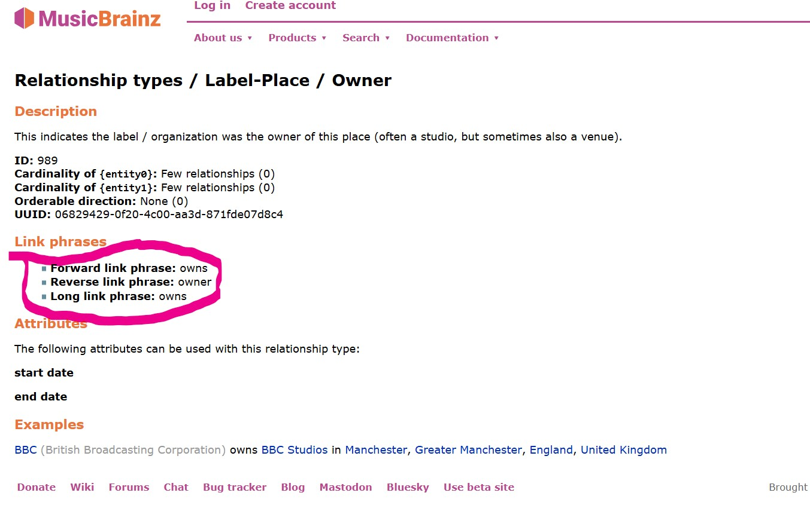

# MusicBrainz: Reconciling Relationships between Entities

The [contributor-role pilot](relationship_preservation.md) supersedes the older
P767 generalization for 33 recording/release-to-artist roles. It preserves stable
source type IDs, specific roles, direction, and relationship qualifiers. Consult
the [mapping inventory](relationship_inventory.md) before changing those entries.
The remaining sections describe legacy mappings outside that bounded pilot.

## Understanding MusicBrainz Relationships

It is important to read this section before you attempt reconciling MusicBrainz relationships against Wikidata.

### Understanding Entity-Type Restrictions

MusicBrainz Relationships ([Official Definition](https://musicbrainz.org/doc/Relationships)) are used to connect two entities.

For example:

- an artist entity may be the `"owner"` of a label entity,
- a label entity may be the `"owner"` of a place entity.

However, the two `"owner"` relationships, despite having the same name, refer to two distinct relationships:

- the [first relationship](https://musicbrainz.org/relationship/610fa594-eeaa-407b-a9f1-49f509ab5559) is `artist-label/owner`, which can only exist between an artist and a label;
- the [second relashionship](https://musicbrainz.org/relationship/06829429-0f20-4c00-aa3d-871fde07d8c4) is `label-place/owner`, which can only exist between a label and a place.

This is due the fact that MusicBrainz, unlike Wikidata, defines each relationship so that it can only connect two very specific entity-types: a relationship that connects artist-label CANNOT be reused to connect label-place.

### Understanding Directionality

Continuing from our previous example:

- Both MusicBrainz properties `artist-label/owner` and `label-place/owner` can likely be replaced by the same Wikidata property, since Wikidata properties are much more generalized.

- As expected, since Wikidata properties are much less specific to music than MusicBrainz relationships, we often must settle for a less-than-ideal match.

- When trying to look up a property for the `artist-label/owner` relationship, you'll notice that there is no "owner" or "owns" property on Wikidata.

- However, there is [owned by(P127)](http://www.wikidata.org/prop/direct/P127), which is the inverse of the owner relationship. This is because most Wikidata properties only exist in one direction (they don't have inverses) because inverse relationships are not necessary for a graph database with a SPARQL endpoint.

- On the other hand, properties in MusicBrainz are **bidirectional**: reusing the above example, the `label-place/owner` property encompasses both `owns` & `owned by`: it can mean one or the other depending on the `entity-type` of the subject and the `entity-type` of the object.

  - When used in the "forward direction" (e.g., BBC `owner` BBC studio), the relationship means "label `owns` place".

  - When used in the "backward direction" (e.g., BBC studio `owner` BBC), the property actually means 'place `owned by` label'.

- Additionally, when a forward relation exists, a backward relation necessarily exists ([except for genre](#note-genre)). For example, if you see (Taylor Swift->`main performer`->The Eras Tour), you are guaranteed to find (The Eras Tour->`main performer`->Taylor Swift) in another file.

- As takeaways:

  - Relationships need to be identified by both the source and target entity types
  - When reconciling properties, we only need to reconcile one direction because the other doesn't exist as a standalone property on Wikidata.

Refer to this image for further clarifications on inverse relationships:

## The Process of Reconciling MusicBrainz Relationships

### Extracting Relationships from JSON

- In the MusicBrainz dataset, the vast majority of relationships between entities are listed in the `relationships` field.

- A few relations are kept in their own fields, such as `artist-credit`, which is the field containing all artists credited for a recording. MusicBrainz handles these relations differently, and thus we will handle them separately.

- The script [`musicbrainz/src/extract_relations.py`](/musicbrainz/src/extract_relations.py) will parse all the JSONL data files and will extract every type relationship in the `relationships` field (e.g. siblings, master engineer) between all entities.

- Given that across all entity types, there are roughly 800 different relation types that all need to be mapped to Wikidata, storing the mappings inside the RDF conversion script would make it very messy.

- Therefore, the result of the script is outputted to [`musicbrainz/src/rdf_conversion_config/relations.json`](/musicbrainz/src/rdf_conversion_config/relations.json), to which we can add Wikidata PIDs manually (note: the script may add missing properties to an existing relations.json, but will not modify any property and mapping that already exists in the json).

### [relations.json](/musicbrainz/src/rdf_conversion_config/relations.json)

- It is located in `musicbrainz/src/rdf_conversion_config`
- It is needed as an input of [`convert_to_rdf.py`](/musicbrainz/src/convert_to_rdf.py)
- Each property in `relations.json` is structured in `subject -> object -> relationship` format:

  - the outermost dictionary key indicates the subject's `entity-type` (e.g. "artist"),
  - the second dictionary key indicates the object's `entity-type` (e.g. "label")
  - the third dictionary key is the relationship's name (e.g. "owner").
  - As discussed above, it is crucial for MusicBrainz relationships to be identified by what it accepts as subject and as object

- The values associated with each relationship are the Wikidata Property ID that the relationship maps to, in string format (e.g. `"P2888"`). If a relationship has no equivalent in Wikidata, it should either be removed or left as `null`/`None`: this would ensure that it is ignored by the RDF conversion script.

#### Note: Same-Type Relationships

Some relationships link two entities of the same type (e.g. area -> area -> part of).

However, as discussed before, relations.json relies on subject and object being of different type to tell the direction of relationship:

- We can tell that "owner" means "owned by" when we see `place -> label -> owner` because we can infer that a place can not "own" a record label ([the documentation](https://musicbrainz.org/relationship/06829429-0f20-4c00-aa3d-871fde07d8c4) can confirm that).

- Yet, in the case of same-type relationships (e.g. area -> area -> part of), we can not infer the direction of the relationship. This is rather important: "Québec is part of Canada" is different from "Canada is part of Québec". Not only that, those two relationships, inverse of each other, would share the same path (`relations.json["area"]["area"]["part of"]`).

To solve this problem:

- We replace each same-type relationship in `relations.json` with `{relationship}_forward` and a `{relationship}_backward` field. This would ensure that there exists `relations.json["area"]["area"]["part of_forward"]` and `relations.json["area"]["area"]["part of_backward"]`, which are inverse of each other.

- The JSON data's `relationships` field contains a `direction` field (containing either `forward` or `backward`) for each relationship. We can use them to map same-type relationships the right direction.

- Often, you will need to consult MusicBrainz documentation because it can be obscure what a relationship mean in forward or backward context. For example, it may not be obvious that [artist->artist->is person_backward](https://musicbrainz.org/relationships/artist-artist) really means that the subject is an alias of the object.

#### Note: Genre

- Despite being considered an entity by the [MusicBrainz relationships table](https://musicbrainz.org/relationships), `genre` is not an entity present in the MusicBrainz dump. Thus, you will only find genre as an object in [`relations.json`](/musicbrainz/src/rdf_conversion_config/relations.json), never as a subject.

- However, all equivalent Wikidata properties relating to genres require the `genre` as subject. Therefore, the RDF conversion script would exceptionally interpret all instances of `relations.json[any_type]["genre"][any_property]` to be the inverse `genre -> any_type -> any_property`. The RDF conversion script handles this by inverting the triple (thus having the genre as the subject) if the target type is `genre`.

## Mapping MusicBrainz Relationships to Wikidata

### Coverage and remaining limits

- The earlier mapping notes reported 409 filled entries out of roughly 800 and estimated 98% coverage of relationship types in at least one direction. These are historical notes, not a current inventory or measured coverage of relationship occurrences in the stored dump.
- The completed [inventory](relationship_inventory.md) and [representation review](representation_review.md) cover the 33 former P767 mappings. They preserve source roles and qualifier evidence in both supported source directions; they do not establish full-dump fidelity or accuracy for all other mappings.
- Legacy null/inverse mappings outside the pilot retain their behavior. Review them against source type definitions and [directionality](#understanding-directionality), preserving distinctions that a broader predicate would discard. Historical prevalence and conversion cost await snapshot access.

### The Relationships Reconciliation Process

OpenRefine only allows reconciliation of items (with QID), but not reconciliation of properties (PID). However, calling Wikidata Search API, which does plaintext search with Wikidata's ElasticSearch engine, can be a useful substitute.

- (I will elaborate on this section of the documentation in another pull request about Wikidata APIs.)

### Notes on Reconciliation Decisions

Below, I will explain a few Wikidata properties that I have frequently mapped onto. Once you understand the decision-making process detailed below, it should be easy to understand all other decisions made in [`relations.json`](/musicbrainz/src/rdf_conversion_config/relations.json):

- location of creation(P1071)

  - A generic Wikidata property that encompasses all the different MusicBrainz location properties (e.g. "edited in", "remixed in", "engineered in", "composed in").

- contributor to the creative work or subject(P767)

  - A generic property for contributors whose role is too specific to exist in Wikidata (e.g. "field recordist", "mix-DJ", "remixer").

  - The release, recording, or work is the **subject**; its contributor is the **object**. Do not reverse this direction. Employer relationships have different semantics and must be checked independently.

  - Despite that we commonly say "this artist is the illustrator of this album", `"performer(P175)"`, `"illustrator(P110)"`, or any similar Wikidata property for contributors needs the person as the object. It is better to understand them as "has performer" and "has illustrator".

- employer(P108)

  - A generic property for contributors whose role is too specific to exist in Wikidata.

  - Must have an event or place (i.e. institution) as object. In the case of the object being a release, a recording, or a work (i.e. composition), use `contributor to the creative work or subject(P767)` instead.

  - Example: I would use "artist -> `employer(P108)` -> place" to express that an artist is a `composer-in-residence` at a place, since this `composer-in-residence` does not exist as a Wikidata property.

  - Contrasting Example: For school director, I would map to "place -> `director / manager(P1037)` -> artist" instead. I avoid using `employer(P108)` whenever there is a more specific relationship.

  - Qualifier preservation for employment and other nonpilot relationships remains separate work. The 33-role contributor pilot already retains supplied dates, attributes, credit text and full relationship JSON on named observations; it does not add that representation to all legacy employment mappings.

- part of(P361) & has part(s)(P527)

  - Very versatile properties that can relate entities of almost any type.

  - Example: band `has part(s)(P527)` band members.

  - Example: track `part of(P361)` album.

- adapted by(P5202)

  - Commonly used Wikidata property for "arranger".

  - `orchestrator(P10806)` can only be used if the musical work is being adapted for orchestra.
